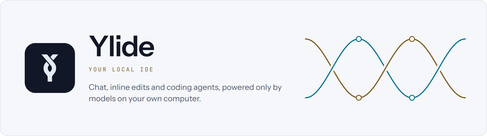
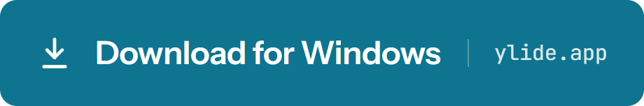
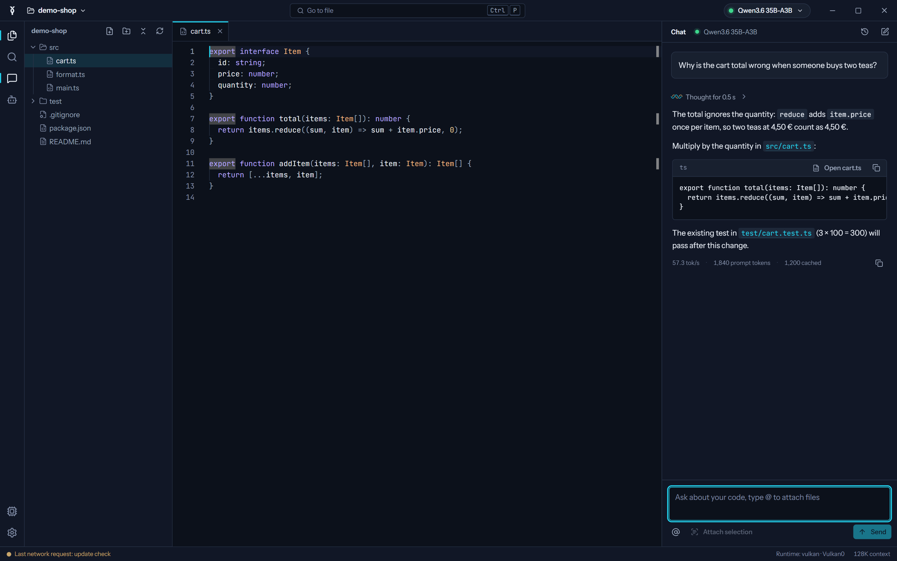
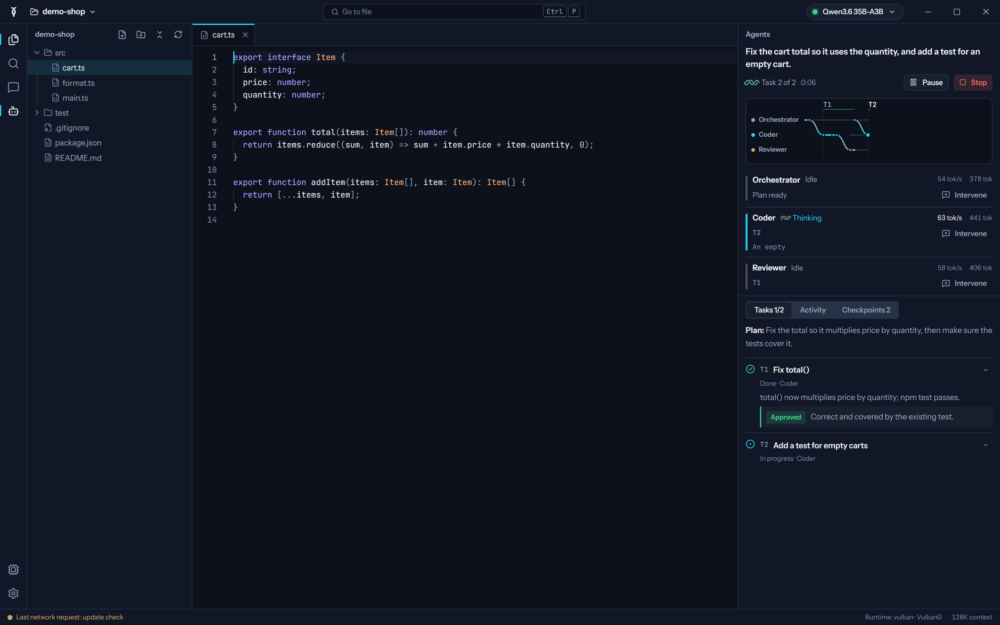
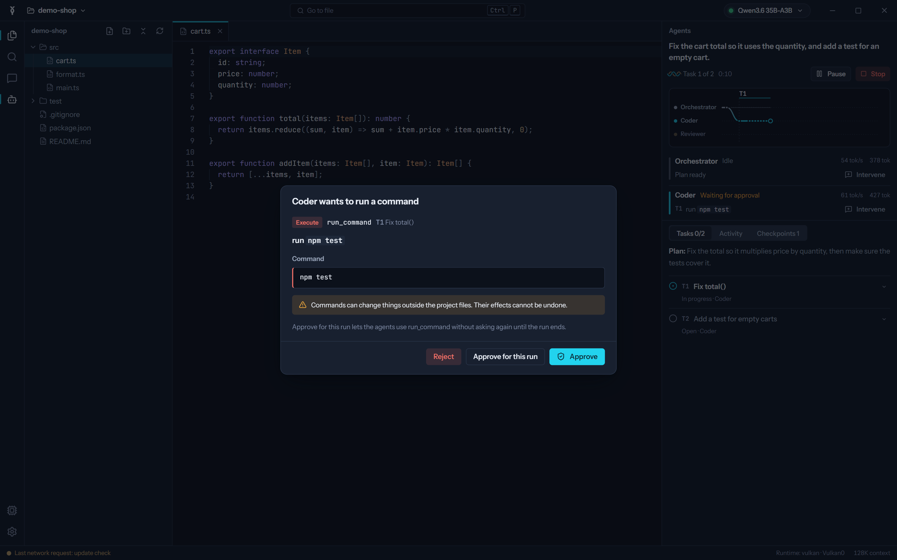
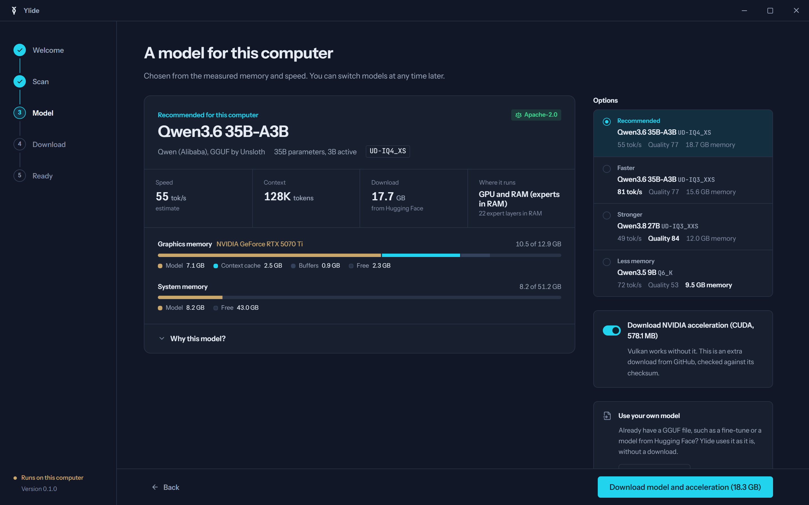
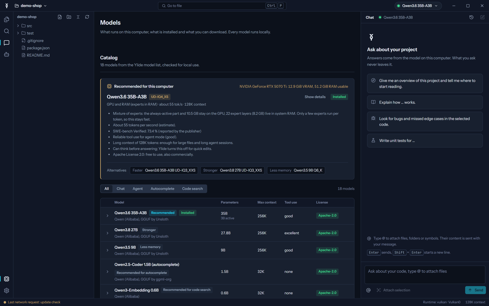
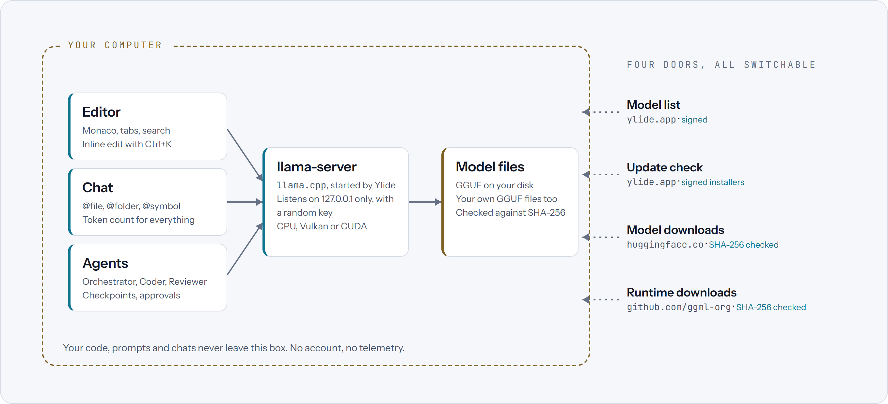
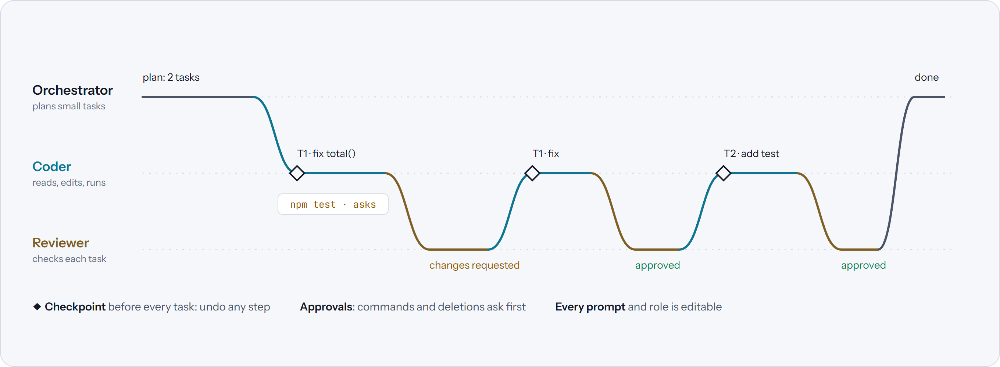

<p align="center">
  <picture>
    <source media="(prefers-color-scheme: dark)" srcset="docs/images/banner-dark.png">
    
  </picture>
</p>

<p align="center">
  <a href="https://github.com/sweeax-exe/ylide/releases/latest"></a>
  <a href="LICENSE"></a>
  <a href="#systemvoraussetzungen"></a>
  <a href="https://discord.gg/GRzTvRGHpr"></a>
  <a href="https://ylide.app/de/"></a>
</p>

<p align="center">
  <a href="https://ylide.app/de/">
    <picture>
      <source media="(prefers-color-scheme: dark)" srcset="docs/images/download-dark.png">
      
    </picture>
  </a>
</p>

<p align="center">
  <a href="README.md">English</a> ·
  <a href="#schnellstart">Schnellstart</a> ·
  <a href="#so-funktioniert-es">So funktioniert es</a> ·
  <a href="#modelle-und-hardware">Modelle</a> ·
  <a href="#aus-dem-quellcode-bauen">Selbst bauen</a> ·
  <a href="docs/trust.md">Download prüfen</a>
</p>

Ylide ist eine quelloffene KI-Coding-IDE im Stil von Cursor, mit einem
Unterschied: **Jedes Modell läuft auf deinem eigenen Rechner.** Chatte mit
deinem Projekt, ändere Code direkt im Editor und lass ein kleines Team aus
Agents (Orchestrator, Coder, Reviewer) Aufgaben erledigen, alles über
[llama.cpp](https://github.com/ggml-org/llama.cpp). Keine Cloud, kein Konto,
keine Telemetrie, und dein Code verlässt deinen Rechner nie.

<p align="center">
  
</p>

## Warum Ylide

- **Privat von Grund auf.** Modelle, Prompts, Chats und Code bleiben auf
  deiner Festplatte. Ylide geht nur für vier Dinge ins Netz, jedes abschaltbar
  und protokolliert: die Modellliste, die Update-Prüfung und die Modell- und
  Laufzeit-Downloads, die du selbst startest.
- **Das richtige Modell für deinen Rechner.** Ein Hardware-Scan misst
  Grafikspeicher, Arbeitsspeicher, CPU und Festplatte und empfiehlt das
  stärkste Coding-Modell, das flüssig läuft, mit passender Quantisierung und
  Kontextlänge, und sagt dir, warum.
- **Agents, denen du zusehen kannst.** Jeder Agent ist eine Linie auf einer
  Zeitleiste, vor jeder Aufgabe entsteht ein Checkpoint zum Zurückspringen,
  und Befehle oder Löschungen fragen vorher. Jeder Prompt und jede Rolle ist
  sichtbar und änderbar.

## Funktionen

- **Einrichtung nach Hardware**: GPU, freier VRAM, RAM, CPU-Funktionen und
  Festplatte, dann eine Empfehlung mit schnelleren, stärkeren und sparsameren
  Alternativen. Download mit einem Klick, fortsetzbar und per SHA-256 geprüft.
- **Läuft mit dem, was du wählst**: Modelle aus der kuratierten Liste, eigene
  GGUF-Dateien und Finetunes oder ein vorhandener OpenAI-kompatibler Server
  (Ollama, LM Studio, llama-server).
- **Editor** auf Basis von Monaco, mit Tabs, Dateibaum, Suche und Datei-Sprung.
- **Chat mit Kontext**: `@file`, `@folder`, `@symbol` und die Auswahl, mit
  Token-Zählung für alles Angehängte. Chats werden pro Projekt gespeichert.
- **Inline-Edit** (<kbd>Strg</kbd>+<kbd>K</kbd>): Änderung beschreiben, Diff
  prüfen, übernehmen oder verwerfen.
- **Agent-Modus** (<kbd>Strg</kbd>+<kbd>Umschalt</kbd>+<kbd>A</kbd>): Der
  Orchestrator plant, der Coder setzt um, der Reviewer prüft jede Aufgabe und
  gibt sie zurück, wenn etwas nicht stimmt.
- **Aktualisiert sich selbst**, nachdem die Signatur des Installers geprüft ist.
- **Elf Sprachen**: Englisch, Deutsch, Spanisch, Französisch, Portugiesisch,
  Chinesisch, Japanisch, Koreanisch, Russisch, Hindi, Indonesisch. Dunkles
  und helles Design.

## Bilder

<table>
  <tr>
    <td width="50%"><p align="center"><sub>Agents bei der Arbeit: Plan, Aufgaben, Review, Zeitleiste</sub></p></td>
    <td width="50%"><p align="center"><sub>Befehle fragen vorher</sub></p></td>
  </tr>
  <tr>
    <td width="50%"><p align="center"><sub>Ein Modell für diesen Rechner</sub></p></td>
    <td width="50%"><p align="center"><sub>Der Katalog, geprüft an deiner Hardware</sub></p></td>
  </tr>
</table>

<sub>Bildschirmfotos von Ylide 0.1.4 mit dem eingebauten Demo-Projekt (englische Oberfläche; Ylide spricht auch Deutsch).</sub>

## Schnellstart

1. **Herunterladen**: Den Installer von [ylide.app](https://ylide.app/de/)
   laden und starten. Er ist mit dem Release-Schlüssel von Ylide signiert
   ([so prüfst du das](docs/trust.md), Englisch). Ein Windows-Codesignatur-
   Zertifikat hat er noch nicht, daher fragt SmartScreen eventuell nach:
   *Weitere Informationen* → *Trotzdem ausführen*.
2. **Scannen und Modell wählen**: Ylide misst deine Hardware und empfiehlt
   ein Modell. Der Download setzt nach Unterbrechungen fort und wird per
   SHA-256 geprüft.
3. **Ordner öffnen** und loslegen: Chat mit <kbd>Strg</kbd>+<kbd>L</kbd>,
   Auswahl ändern mit <kbd>Strg</kbd>+<kbd>K</kbd>, Aufgabe an die Agents mit
   <kbd>Strg</kbd>+<kbd>Umschalt</kbd>+<kbd>A</kbd>, Datei öffnen mit
   <kbd>Strg</kbd>+<kbd>P</kbd>.

Fragen? Im deutschen Kanal oder in `#help` auf dem
[Ylide-Discord](https://discord.gg/GRzTvRGHpr).

## So funktioniert es

<p align="center">
  <picture>
    <source media="(prefers-color-scheme: dark)" srcset="docs/images/how-it-works-dark.png">
    
  </picture>
</p>

Ylide startet `llama-server` von llama.cpp als überwachten Kindprozess, der
nur auf `127.0.0.1` lauscht, mit einem zufälligen Schlüssel. Editor, Chat und
Agents sprechen mit ihm wie mit jedem OpenAI-kompatiblen Server; die
Modelldateien bleiben, wo sie sind. Ylide liefert CPU- und Vulkan-Builds von
llama.cpp mit (GPUs von NVIDIA, AMD und Intel); NVIDIA-Karten können ein
optionales CUDA-Paket dazunehmen.

### Die Agents

<p align="center">
  <picture>
    <source media="(prefers-color-scheme: dark)" srcset="docs/images/agents-dark.png">
    
  </picture>
</p>

Der Orchestrator sieht sich das Projekt an und zerlegt die Anfrage in kleine
Aufgaben. Der Coder nimmt sich eine nach der anderen vor; ein Checkpoint vor
jeder Aufgabe macht jeden Schritt rückgängig machbar. Der Reviewer prüft jede
fertige Aufgabe und gibt sie mit Hinweisen zurück, wenn etwas nicht stimmt.
Du legst fest, wie viel die Agents selbst dürfen: Standardmäßig laufen Lesen
und rückgängig machbare Änderungen automatisch, Befehle und Löschungen warten
auf deine Freigabe.

## Datenschutz

Ylide hat kein Konto, keine Telemetrie und kein Cloud-Backend. Es geht nur
für vier Zwecke ins Netz, jeder abschaltbar unter *Einstellungen → Netzwerk
und Datenschutz* und im Netzwerkprotokoll vermerkt:

| Tür | Wohin | Was sie schützt |
|---|---|---|
| Modellliste | `ylide.app` | signiert mit dem Release-Schlüssel |
| Update-Prüfung | `ylide.app` | sendet nur `Ylide/<Version>`; Installer sind signiert |
| Modell-Downloads | `huggingface.co` | SHA-256 aus der signierten Modellliste |
| Laufzeit-Downloads | `github.com/ggml-org/llama.cpp` | SHA-256 aus der signierten Modellliste |

ylide.app führt kein Zugriffsprotokoll. Deine Projekte, Prompts und Chats
werden nirgendwohin hochgeladen. Wie Releases und Modellliste signiert sind
und wie du einen Download selbst prüfst: [docs/trust.md](docs/trust.md)
(Englisch).

## Systemvoraussetzungen

| | |
|---|---|
| Betriebssystem | Windows 10 oder 11, 64 Bit. macOS und Linux folgen; der Kern ist plattformübergreifend. |
| Laufzeit | WebView2 (in Windows 11 enthalten; der Installer ergänzt es, falls es fehlt) |
| Arbeitsspeicher | 16 GB oder mehr empfohlen; kleine Modelle laufen auch mit weniger |
| Grafik | Optional. GPUs von NVIDIA, AMD und Intel über Vulkan; NVIDIA zusätzlich über das optionale CUDA-Paket |
| Festplatte | Etwa 25 MB für den Installer, dazu 1 bis 50 GB für Modelle |

## Modelle und Hardware

Der Hardware-Scan wählt Modell, Quantisierung und Kontextlänge für genau
deinen Rechner. Als grobe Orientierung:

| Modell | Art | Download | Läuft gut mit |
|---|---|---|---|
| Qwen3.6 35B-A3B | MoE, 35B (3B aktiv) | 13–37 GB | 12 GB VRAM + 32 GB RAM (Experten im RAM) oder 24 GB VRAM |
| Qwen3-Coder-Next 80B-A3B | MoE, 80B (3B aktiv) | 38–50 GB | 16 GB VRAM + 64 GB RAM |
| Qwen3.8 27B | dicht, 27,8B | 11–29 GB | 12–24 GB VRAM |
| Qwen3.6 27B | dicht, 27B | 15–29 GB | 16–24 GB VRAM |
| Muse Glimmer 30B | dicht, 29,6B | 17–20 GB | 20–24 GB VRAM |
| gpt-oss 20B | MoE, 21B (3,6B aktiv) | 12 GB | 16 GB VRAM oder 8 GB VRAM + RAM |
| Gemma 4 12B | dicht, 12B | 7–13 GB | 8–16 GB VRAM |
| Qwen3.5 9B | dicht, 9B | 6–10 GB | 8–12 GB VRAM |
| Qwen3.5 4B | dicht, 4B | 3–5 GB | 4–6 GB VRAM oder die CPU |
| Qwen3.5 2B | dicht, 2B | 1–2 GB | die CPU (nur Chat) |

Helfer laufen neben dem Hauptmodell: Qwen2.5-Coder 0.5B, 1.5B oder 7B für die
Autovervollständigung und Qwen3-Embedding 0.6B oder EmbeddingGemma 2 für die
Code-Suche. Drei unzensierte Varianten stehen ebenfalls im Katalog; sie sind
gekennzeichnet und werden nie empfohlen. Die Lizenz jedes Modells wird vor dem
Download angezeigt; die Aufnahmeregeln stehen in
[docs/registry.md](docs/registry.md) (Englisch).

## Aus dem Quellcode bauen

Voraussetzungen:

- [Rust](https://rustup.rs) 1.88 oder neuer (MSVC-Toolchain)
- [Node.js](https://nodejs.org) 20.19 oder neuer
- Visual Studio Build Tools 2022 mit dem Workload „Desktopentwicklung mit C++“
- Git

```bash
git clone https://github.com/sweeax-exe/ylide.git
```

```bash
cd ylide
```

```bash
npm install
```

```bash
node scripts/fetch-runtime.mjs
```

Der letzte Schritt lädt die mitgelieferten llama.cpp-Builds (CPU und Vulkan,
etwa 50 MB) von den offiziellen llama.cpp-Releases und prüft ihre Prüfsummen.

App im Entwicklungsmodus starten:

```bash
npm run dev
```

Installer bauen (`target/release/bundle/nsis/`):

```bash
npm run build
```

Dein eigener Build läuft genau wie ein Release, kann sich aber nicht über
ylide.app aktualisieren: Updates müssen mit dem Release-Schlüssel signiert
sein, und der liegt nicht in diesem Repository ([docs/trust.md](docs/trust.md)).

### Tests

```bash
cargo test --workspace
```

```bash
npm test -w apps/desktop
```

Der End-to-End-Test gegen ein echtes Modell ist optional:

```bash
cargo test -p ylide-desktop --lib e2e -- --ignored --nocapture
```

Er braucht `YLIDE_E2E_MODEL` mit dem Pfad zu einer GGUF-Datei (zum Beispiel
Qwen3.5-4B Q4_K_M aus der Registry).

### Oberfläche ohne Tauri entwickeln

`node node_modules/vite/bin/vite.js apps/desktop` stellt die Oberfläche unter
http://localhost:1420 bereit, mit einem Mock-Backend im Browser
(Demo-Projekt, simulierte Downloads, gestreamter Chat und ein geskripteter
Agent-Lauf). Mit `?workbench` wird das Onboarding übersprungen.

## Projektaufbau

```text
apps/desktop/
  src-tauri/        Tauri-App: Befehle, Dienste, Updater, Signaturen
  src/              React-Oberfläche: Onboarding, Editor, Chat, Agents, Einstellungen
crates/
  hardware/         GPU, VRAM, RAM, CPU und Festplatte erkennen
  registry/         Schema der Modellliste, Speicherschätzung, Empfehlungen
  downloader/       fortsetzbare, per Prüfsumme geprüfte Downloads
  inference/        llama-server überwachen, Streaming-Client, Scheduler
  workspace/        abgesicherter Projektzugriff, Suche, @-Kontext
  agent/            Werkzeuge, Rechte, Checkpoints, Orchestrator
registry/           die Modellliste (models.json)
scripts/            Laufzeit-Download, Release und Veröffentlichung
tools/              Übersetzungsprüfung, Pflege der Modellliste
website/            ylide.app
docs/               Architektur, Design, Registry, Releases, Vertrauen
```

Mehr dazu (Englisch): [Architektur](docs/architecture.md),
[Designsprache](docs/design.md), [Modellliste](docs/registry.md),
[Releases](docs/releasing.md), [Roadmap](docs/roadmap.md).

## Mitmachen

Fehlermeldungen, Modellvorschläge, Übersetzungen und Code sind willkommen.
Der Einstieg steht in [CONTRIBUTING.md](CONTRIBUTING.md) (Englisch); Fragen
gern auf dem [Discord](https://discord.gg/GRzTvRGHpr). Dieses Repository
bekommt einen Commit pro veröffentlichter Version, getaggt wie `v0.1.4`;
angenommene Pull Requests übernehmen wir in den Entwicklungsstand, und sie
erscheinen mit dem nächsten Release.

Sicherheitslücken bitte nicht öffentlich melden, sondern wie in
[SECURITY.md](SECURITY.md) beschrieben. Für alle Beteiligten gilt der
[Verhaltenskodex](CODE_OF_CONDUCT.md).

## Lizenz

Ylide steht unter der [Apache License 2.0](LICENSE). Komponenten von
Drittanbietern und ihre Lizenzen: [THIRD_PARTY_NOTICES.md](THIRD_PARTY_NOTICES.md).
Modelle haben eigene Lizenzen, die vor jedem Download angezeigt werden. Der
Name Ylide und das Logo fallen nicht unter die Lizenz; Forks nutzen bitte
einen eigenen Namen.
