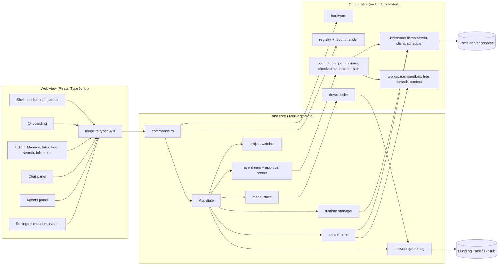
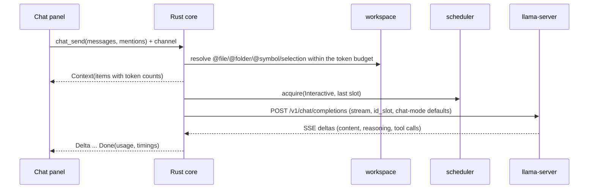

# Ylide architecture

Ylide is a desktop IDE with chat, inline edits and coding agents that runs
models **only on the user's machine**. This document explains how it is built
and why.

## 1. Stack decision

| Criterion (5 = best for a small team) | **Tauri 2 + Monaco** | Electron + Monaco | Fork of Code-OSS (like Cursor) |
|---|---|---|---|
| Effort to MVP | 3 | 3-4 | 5 |
| Runtime performance | 4 | 4 | 3 |
| Memory (Windows / macOS + Linux) | 3 / 5 (WebView2 is Chromium-based) | 2-3 | 2 |
| Installer size | 5 (a few MB + runtimes) | 2 (85-150 MB) | 1 (~240 MB) |
| Cross-platform consistency | 3 (three web engines) | 5 | 5 |
| Extensibility | 3 (own plugin API, MCP/LSP later) | 3 | 5 (Open VSX only; Microsoft's marketplace is off limits for forks) |
| Maintainability for 2-5 people | **4** | 4 | **1** (weekly upstream merges; Void and PearAI stalled on this path) |
| License fit | 5 | 5 | 4 |

**Decision: Tauri 2 with a Rust core, a React/TypeScript UI and Monaco as the
editor.** The deciding factors are maintainability and the fact that the hard
parts of Ylide (hardware probing, process supervision, downloads, the agent
loop) are systems code that belongs in Rust anyway. A VS Code fork would give
the most features on day one and the worst long-term cost. Electron would work,
but brings 100+ MB and little benefit on Windows, where WebView2 is already a
Chromium engine. Monaco is wrapped thinly so that CodeMirror 6 remains a
fallback for WebKit-based platforms if needed.

**Inference: llama.cpp `llama-server` as a supervised child process**, one
folder per backend (CPU, Vulkan, CUDA, ROCm, Metal). Running it out of process
gives crash isolation (a GPU out-of-memory abort never takes the IDE down),
clean VRAM release, backend choice at runtime and independent updates.
Ollama and LM Studio were considered; both can be connected as an *external
OpenAI-compatible endpoint*, but Ylide does not depend on them (no slot
control, no `/infill`, extra downloads).

**License: Apache-2.0.** It is permissive like MIT, adds an explicit patent
grant (relevant in ML tooling) and protects the project name. All
dependencies are MIT, Apache-2.0, BSD, ISC, Unlicense, CC0, Zlib or OFL (fonts).

## 2. Components



| Crate | Responsibility |
|---|---|
| `hardware` | GPUs (DXGI, D3D12 UMA check, NVML for free VRAM and compute capability), RAM, CPU features, disk, acceleration (CUDA driver API, Vulkan, DirectML). One `PlatformProbe` implementation per OS; Linux and macOS variants exist and compile. |
| `registry` | Registry types and validation, cache with bundled fallback, memory estimation (weights + KV cache incl. hybrid/SWA/MoE layouts + compute buffers), placement planning (GPU, MoE expert offload, partial offload, unified memory, CPU) and the recommendation with localizable reasons. |
| `downloader` | Resumable, SHA-256 verified HTTP downloads with retry, pause and multi-file jobs. |
| `inference` | llama-server process management (free port, per-launch API key passed by file, job object, orphan cleanup, log ring buffer), OpenAI-compatible streaming client (SSE parser, tool-call assembly), FIM and embeddings calls, slot scheduler with priorities and cache affinity. |
| `workspace` | Sandboxed project access (no escape via `..`, symlinks, UNC/device paths, alternate data streams or reserved names), file tree honoring `.gitignore`, ripgrep-based search, fuzzy file finder, symbol finder, @-mention context resolution with token budgets. |
| `agent` | Tools with JSON schemas, permission modes and hard denials, content-addressed checkpoints, the agent loop and the orchestrator with Coder and Reviewer. |
| `apps/desktop/src-tauri` | Tauri commands, settings, network gate, model store, runtime manager, chat/inline/agent wiring, file watcher. |

## 3. Folder structure

```
ylide/
  Cargo.toml                 workspace: crates/* + apps/desktop/src-tauri
  package.json               npm workspace root (scripts)
  crates/
    hardware/  registry/  downloader/  inference/  workspace/  agent/
  apps/desktop/
    src-tauri/               Rust app crate (commands, state, services)
      prompts/               default chat and inline prompts (editable in settings)
      resources/runtime/     bundled llama.cpp builds (fetched, not committed)
    src/
      bindings/              TypeScript types generated from Rust (ts-rs)
      design/                tokens, themes, Monaco theme
      i18n/locales/{de,en}/  one JSON file per feature
      lib/                   ipc.ts (typed API), mock.ts (browser mock), format, errors
      state/                 app, layout, editor bridge, toasts
      components/            shared UI building blocks
      shell/                 workbench layout, title bar, status bar
      features/              onboarding, editor, chat, agents, settings
  registry/
    models.json              the model registry (versioned data)
    schema/registry.schema.json
  tools/registry/            fill.mjs (sizes, hashes, pinned revisions), gguf-meta.mjs
  scripts/fetch-runtime.mjs  downloads and verifies bundled runtimes
  docs/                      architecture, design, registry, roadmap
```

## 4. Data flows

### Chat with project context



Context blocks are attached to the newest user message only, so the earlier
conversation stays byte-identical and llama-server reuses its KV cache.

### Inline edit

Selection + instruction -> core builds a prompt with up to 60 read-only lines
before and after -> streamed replacement -> the editor shows a diff preview ->
Accept applies it as one undoable edit, Reject discards it.

### Agent run

```mermaid
sequenceDiagram
  participant UI as Agents panel
  participant O as Orchestrator (Rust)
  participant P as Planner role
  participant C as Coder role
  participant R as Reviewer role
  participant T as Tools / checkpoints
  UI->>O: agent_start(goal)
  O->>P: explore read-only, submit_plan
  P-->>O: plan (tasks)
  loop each task
    O->>T: begin checkpoint
    O->>C: task + team progress
    C->>T: read/search/edit/run (permission check, approval dialog if needed)
    C-->>O: finish(summary)
    O->>R: task + summary + diff of the checkpoint
    R-->>O: submit_review(approve | request_changes)
    alt changes requested and rounds left
      O->>C: feedback appended to the same conversation
    end
  end
  O-->>UI: run finished (outcome, summary); every event streamed live
```

## 5. Model registry

`registry/models.json` is versioned data in the repository. The app ships a
copy (offline fallback), loads a newer version from the repository at startup
when allowed (conditional GET with ETag) and caches it. The schema is
`registry/schema/registry.schema.json` (JSON Schema 2020-12); `docs/registry.md`
explains every field.

Key fields per model: `id`, `name`, `roles` (chat, agent, fim, embedding),
`license` (SPDX id, commercial use flag, notes), `architecture` (layers,
attention layers, KV heads, head dims, sliding window, expert share,
recurrent state), `context`, `capabilities` (tool calling level, reasoning),
`quality` (curated 0-100 scores used for ranking), `requestDefaults` per mode
(sampling and chat-template switches), `source` (Hugging Face repo and a
pinned commit), `variants` (quantization, files with size and SHA-256),
`benchmarks` (with source URL and a self-reported flag), `llamaArgs`.
`runtimes` lists the llama.cpp builds with their assets and digests;
`gpuHints` holds memory bandwidth figures for speed estimates.

Maintainers never type hashes: `node tools/registry/fill.mjs --pin` pins
revisions and fills sizes and SHA-256 from Hugging Face and GitHub, and
`node tools/registry/gguf-meta.mjs --registry` reads every model's GGUF
header with HTTP range requests to verify the architecture values.

## 6. Recommendation

1. The hardware probe measures free VRAM (NVML on NVIDIA; DXGI's budget is
   not used because it overstates free memory while the desktop uses the GPU),
   RAM, CPU features and disk space.
2. For every model, quantization, context length (128K, 64K, 32K, 16K, 8K)
   and KV cache type, the planner tries placements in order of speed and
   estimates decode speed from the bytes read per token and the memory
   bandwidth of GPU and RAM (MoE models read only their active experts).
3. Candidates are scored by curated quality minus quantization loss minus a
   context penalty (agents need long context) plus a logarithmic speed bonus.
   Autocomplete gets VRAM reserved next to the main model when that costs
   little.
4. The result: a primary pick plus *faster*, *stronger* and *less memory*
   alternatives, each with reason codes that the UI translates.

On the reference machine (RTX 5070 Ti 16 GB, 64 GB RAM) this yields
Qwen3.6-35B-A3B at 128K context with 22 expert layers in RAM (~55 tok/s
estimated), autocomplete on the GPU and embeddings on the CPU.

### Launch flags

`chat_args` (`apps/desktop/src-tauri/src/runtime.rs`) builds the
llama-server command line from the memory plan that `plan_for`
(`apps/desktop/src-tauri/src/commands.rs`) computes on every start. It tries
the contexts [settings override or the model's recommended value, 64K, 32K,
16K, 8K] (those up to the model's maximum), at each one an F16 KV cache first
and q8_0 only when F16 does not fit, and returns the first plan that fits. A
model that is not in the registry has no plan.

Some flags depend on what the build's `--help` lists (parsed once per
binary):

* Only when listed: `--fit` (and with it `--fit-target`), `--cache-ram`,
  `--metrics`, `--no-webui` and `--offline`.
* When listed, or when `--help` yields nothing: `-kvu` / `--kv-unified`,
  `-fa` and `-dev none`. The registry's `llamaArgs` are filtered against the
  list and pass unfiltered without one.
* Not checked against the list: `-m`, `--alias`, `-c`, `-np`, `-ngl`,
  `--n-cpu-moe`, `-b` / `-ub`, `-ctk` / `-ctv` and `-t`. `-dev <id>` depends
  on `--list-devices` instead, and the user's extra arguments are never
  filtered.

In command-line order:

* `-m <file> --alias chat`.
* **Context and slots**: `-np <slots>` (setting, default 2, at most 8). With
  `-kvu` (unified KV cache; `--kv-unified` on builds that only know the long
  form) all slots share one cache of `-c <context>` tokens. Without it
  llama.cpp splits `-c` evenly between slots, so Ylide passes
  `-c <context * slots>` to give every slot the full window. The context is
  the settings override, else the plan's, else the model's recommended value
  capped at 32K, else 16K for a model that is not in the registry. If the
  server exits during startup with an out-of-memory message, it is started
  again with half the context (not below 8K, at most two retries).
* **Flash attention**: `-fa on`.
* **GPU placement**:
  * CPU runtime or CPU plan: `-ngl 0`, plus `-dev none` on a GPU build.
  * Build with `--fit`: `--fit on --fit-target 1024` for every other
    placement (GPU, unified memory, MoE offload, partial offload, no plan) and
    **no `-ngl`**. At load time llama.cpp measures free memory and moves MoE
    experts, then whole layers, to RAM until the rest fits with 1 GiB left
    for the desktop and other programs. It does this only when the placement
    is left to it: with an explicit `-ngl` it logs "n_gpu_layers already set
    by user", with a tensor override "tensor_buft_overrides already set by
    user", and skips fitting. An over-full GPU then spills into shared system
    memory, which is several times slower.
  * Otherwise the planned split, with a margin for estimation error:
    `-ngl 999` (GPU, unified memory, no plan),
    `-ngl 999 --n-cpu-moe <expert layers + 2>` (MoE offload),
    `-ngl <gpu layers - 1>` (partial offload). This covers builds without
    `--fit`, user arguments that stop fitting and the restart after a failed
    fit (both below).
  * MoE offload adds `-b 2048 -ub 2048` in every case: larger batches speed
    up prompt processing while the experts are in RAM.
  * **User arguments that stop fitting** (in the settings, see below):
    `-ngl` / `--gpu-layers` / `--n-gpu-layers` with any value but `auto`
    (llama.cpp's default), the tensor overrides `-ncmoe` / `--n-cpu-moe`,
    `-cmoe` / `--cpu-moe`, `-ncffn` / `--n-cpu-ffn` and `-ot` /
    `--override-tensor`, `-sm` / `--split-mode tensor` (llama.cpp cannot fit
    that split mode), and `--fit` switched off (`off`, `false`, `0` or
    `disabled`), each as `-flag value` or `--flag=value` (b11669 itself only
    accepts the first form). Ylide logs a warning and passes the planned
    split instead of `--fit`; the user arguments come after it, so a user's
    `-ngl` still wins. Tensor overrides add up instead of replacing each
    other, and llama.cpp applies the first one that matches a tensor, so
    when the user places the experts themselves (`--n-cpu-moe`, `--cpu-moe`,
    or an `-ot` pattern that mentions `exps`) the planned `--n-cpu-moe` is
    left out (only `-ngl 999`); an `-ot` for other tensors keeps it.
  * **Failed fit**: when fitting fails for another reason, llama.cpp logs
    "failed to fit params" and keeps every layer on the GPU (about 5x slower
    on the reference machine, see below). Once the server is ready, Ylide
    looks for that line (or "error while trying to fit params") in the
    captured startup log. For a MoE or partial offload plan it then stops
    the server and starts it once more with the planned split, and the
    server log view shows a line saying so. For a GPU, unified memory or no
    plan the planned split puts every layer on the GPU as well, so there is
    no restart.
* **Device**: `-dev <id>` for GPU runtimes (not with a CPU plan). Ylide runs
  `--list-devices` and picks the device whose name matches the hardware
  probe's primary GPU, the dedicated GPU with the most usable VRAM (an iGPU
  only on machines without one), else the first listed device. The name
  match keeps the model off an iGPU next to a dedicated GPU. Without a
  probed GPU, or when `--list-devices` fails, no `-dev` is passed.
* **KV cache**: `-ctk q8_0 -ctv q8_0` when the plan uses a q8_0 cache, which
  `plan_for` picks only when F16 does not fit at that context; otherwise
  llama.cpp's F16 default.
* **Threads**: `-t <physical cores>`.
* **`--cache-ram`**: RAM for llama-server's prompt cache, which keeps the KV
  state of earlier prompts for reuse: 8192 MiB with 48 GiB of RAM or more,
  4096 MiB from 24 GiB, else 1024 MiB.
* `--metrics`, `--no-webui`, `--offline`: metrics endpoint, no built-in web
  UI, no network access by llama.cpp itself.
* **Per-model arguments**: the registry's `llamaArgs` (e.g. `--jinja
  --reasoning-format deepseek` for Qwen3.6), or `--jinja` for a model that is
  not in the registry. Flags the build does not know are dropped together
  with their value (the next token, unless it starts with `-`), with a
  warning in the log.
* **User arguments** ("Extra llama-server arguments" in the settings) come
  last and are not filtered, so single-value flags override the values
  above. The ones that stop fitting are listed under GPU placement.

`LlamaServer` (`crates/inference/src/server.rs`) adds the rest, so
`chat_args` never contains it and the command shown in the UI has no host,
port or key:

* `--host 127.0.0.1 --port <port>`: a free port found by binding
  `127.0.0.1:0`; the server is not reachable from other machines.
* `--api-key-file <run dir>/llama-<port>.key`: a random key (24 bytes, hex)
  per launch, written to a file so it never appears in the process list and
  deleted when the server stops. Without a key folder `--api-key` would be
  used; the app always passes one.
* The pid is written to `<run dir>/chat.pid`; the next start first kills a
  llama-server left behind by a crashed session and waits up to 5 seconds
  for it to exit, so that its VRAM is free again before `--fit` measures.
* The server counts as started once `/health` reports ready. It is polled
  every 250 ms (status "loading" while the model loads) for up to 15
  minutes; an exit during startup fails with the last 40 log lines. When the
  start fails (spawn error, exit or timeout), the key file and the pid file
  are removed again.

Measured on the reference machine (RTX 5070 Ti 16 GB, Ryzen 9 9950X3D,
64 GB RAM; Qwen3.6-35B-A3B UD-IQ4_XS, 128K context, 2 slots):

| Placement flags | Generation | Prompt |
|---|---|---|
| `-ngl 999 --fit on` | 16.5 tok/s | 418 tok/s |
| `--fit on` | **80 tok/s** | **1392 tok/s** |
| `-ngl 999 --n-cpu-moe 22` | 67.5 tok/s | 1313 tok/s |

With `-ngl 999` llama.cpp skipped fitting ("n_gpu_layers already set by
user") and the GPU spilled about 7 GB into shared system memory. `--fit on`
alone moved MoE experts to RAM instead and was faster than the planned fixed
expert split (22 layers, measured without the fallback's +2 margin).

## 7. Sub-agent protocol

* **Roles** are data (`RoleDefinition`: id, name, description, system prompt,
  allowed tools, optional model and temperature, step limit). The defaults are
  Orchestrator (plans), Coder (implements) and Reviewer (reviews, never
  edits). Users can edit them and add their own roles; the planner may assign
  tasks to custom roles.
* **Shared state** is the run's `Blackboard`: plan, tasks with status, results
  and reviews, messages between agents, changed files. Every agent prompt
  includes a compact overview of it.
* **Messages**: `question`, `answer`, `feedback`, `intervention`, `note`.
  Agents ask each other (or the user) with the `ask` tool; the orchestrator
  routes the question and answers it with the asked role's prompt.
* **Events** to the UI: run started, status per agent (state, step, tok/s),
  deltas, plan ready, task updated, tool call/result with file changes,
  approval requested, question for the user, message, checkpoint created, run
  finished.
* **Templates** for every message the orchestrator writes are visible and
  editable (no hidden prompts).

### Execution strategy on one GPU

Usually only one large model fits into VRAM. Ylide therefore:

* runs **one llama-server** for the main model with **2 parallel slots** and a
  **unified KV cache** (`-np 2 -kvu`): slot 0 for agents, the last slot for
  interactive chat and inline edits, which overtake agent work in the
  scheduler (priorities: interactive > agent > background);
* runs **sub-agents one after another**: decode speed is memory-bandwidth
  bound, so parallel generation on the same GPU would slow every agent down;
* **pins agents to their slot** (`id_slot`) and keeps conversations
  append-only so llama-server can reuse the cached prompt prefix; the Coder
  continues its own conversation after review feedback, so only the feedback
  has to be processed. Hybrid models (Qwen3.5/3.6/3.8) cannot shift their KV
  cache, so old tool output is condensed in one go at 75 % of the window
  instead of piecemeal;
* lets roles name **a smaller model** (e.g. a 4B helper) where that is good
  enough.

## 8. Safety and privacy

* **Network**: four purposes only (registry update, model download, runtime
  download, update check with the installer download that follows it), each
  switchable and logged in a log visible in the settings. Updates are verified
  against a minisign key built into the app; see docs/releasing.md.
  HTTPS only, User-Agent `Ylide/<version>` without any identifier. No
  telemetry, no accounts. The web view itself cannot reach the network
  (CSP `connect-src ipc:`); model servers listen on 127.0.0.1 with a random
  API key passed via a file.
* **Agent permissions**: `ask` (every change needs a click), `autoSafe`
  (default: reads and undoable edits run, commands and deletions ask) and
  `autonomous`. Command and deletion confirmations stay on until the user
  turns them off. Allow-listed command prefixes never auto-approve chained
  commands. Destructive commands (formatting drives, recursive deletes of a
  drive or home, force-push, download-and-execute pipes, shutdown) are blocked
  in every mode. Credential files (`.env`, keys, `~/.ssh`) are invisible to
  agents. Existing files must be read before they may be overwritten.
* **Checkpoints**: before an agent changes a file, its previous state is
  stored (content-addressed) per task; any task can be undone. Effects of
  shell commands outside tracked files cannot be undone; the UI says so.

## 9. Cross-platform

Platform-specific code is confined to `hardware/src/platform/*`,
process supervision (job objects on Windows, process groups on Unix) and the
runtime asset selection. Linux (sysfs, NVML) and macOS (unified memory)
probes already compile; see `docs/roadmap.md` for what the port adds.
